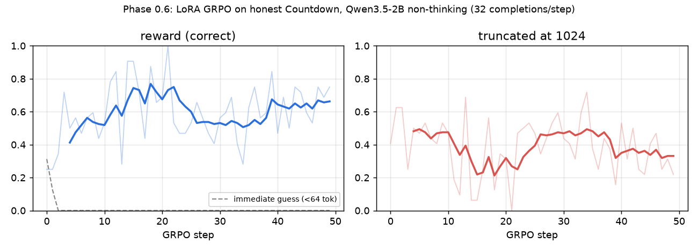

# Phase 0: environment and de-risking

Run 2026-11-20 on the RTX 5070 Ti (16 GB, sm_120). Raw numbers are in `results/phase0/`, and each
step's script is in `scripts/p0_*.py`.

**Verdict: stay on Qwen3.5-2B.** Every gate in the plan passed within one day. One plan change:
**run RL in non-thinking mode**, with the reasoning written as visible text (see 0.5).

## Environment

uv project, Python 3.12. `uv sync` builds it from `pyproject.toml` / `uv.lock`.

| Package | Version | Why this version |
|---|---|---|
| torch | 2.14.0+cu130 | Pinned by vLLM 0.33; sm_120 is in the arch list |
| vLLM | 0.33.0 | Newest release TRL's `vllm` extra accepts (<0.34) |
| transformers | 5.20.2 | vLLM 0.33 requires <5.21 |
| TRL | 1.18.2 | GRPOTrainer, vLLM colocate mode, native multi-turn tool calling (useful for Phase 1) |
| PEFT | 0.22.0 | |
| flash-linear-attention | 0.6.0 | Triton kernels for the Gated DeltaNet layers |
| jlens | anthropics/jacobian-lens@581d398 | Reference J-lens |

Notes:
- `causal_conv1d` is not installed, so transformers falls back to the torch conv. It is correct,
  just slower. It is only worth building if GRPO training turns out to be conv-bound.
- **Use the text-only checkpoint** at `/home/wil/models/qwen3.5-2b-text` (made by
  `scripts/make_text_only_ckpt.py`) for TRL and vLLM. With the original multimodal repo, vLLM
  profiles the vision encoder with dummy images and OOMs in colocate mode, and PEFT `all-linear`
  wraps the vision tower.
- vLLM on this hybrid model needs one Mamba state block per running sequence. At low
  `gpu_memory_utilization`, cap `max_num_seqs`. TRL sets it to batch × steps_per_generation,
  which is small enough.
- vLLM spawns its engine process: scripts need an `if __name__ == "__main__"` guard and must not
  `os._exit`, which leaves an orphaned EngineCore holding GPU memory.
- The reference repos (jacobian-lens, GRAFT, jpp_lens) are shallow-cloned into `external/`, which
  is gitignored.

## 0.1 Blackwell support ✅

torch reports capability (12, 0) with sm_120 compiled in. fla's `chunk_gated_delta_rule` runs
forward and backward with finite gradients. bitsandbytes 4-bit linear works. vLLM serves the model
(0.5 and 0.6).

## 0.2 Forward/backward through DeltaNet ✅

- Loads text-only as `Qwen3_5ForCausalLM`: 1.88B params, 3.8 GB in bf16. Greedy decoding is coherent.
- 1024-token forward+backward with full parameter gradients: 0.19 s, 10.9 GB peak.
- All 24 layers (18 Gated DeltaNet, 6 gated attention) get non-zero, finite parameter gradients
  and residual-stream gradients. No parameter is missing a gradient.
- fla kernel vs pure-torch reference: identical loss (1.2032), minimum residual-gradient cosine
  0.997 across layers (bf16 noise), and the fla path is 2× faster.

## 0.3 Fitting the J-lens ✅

`jlens.fit` runs unmodified: `from_hf` finds the layout itself.

- 100 FineWeb (sample-10BT) prompts × 128 tokens, dim_batch 8: **25 min, 15 s/prompt, 6.7 GB**.
- The fit is compute-bound (~56 ms per backward pass of 8 × 128 tokens). dim_batch 16/24 is
  *slower* per prompt and 32+ OOMs, so cost is about 15 s × N prompts: **1000 prompts (paper
  scale) ≈ 4 h**, a good overnight job.
- The lens file is 193 MB in fp16 (23 layers × 2048²), kept in `runs/jlens/` and not committed.

## 0.4 Lens sanity check ✅

Scored on three of the jlens repo's own lens-quality eval sets. Readout is at the last prompt
token; a hit means the minimum rank over layers ≤ k:

| Eval (n) | J-lens pass@1 | logit lens pass@1 | J-lens pass@10 | logit lens pass@10 |
|---|---|---|---|---|
| multihop (103) | **0.36** | 0.09 | **0.53** | 0.37 |
| typo (96) | **0.49** | 0.25 | **0.78** | 0.58 |
| association (102) | 0.00 | 0.00 | 0.02 | 0.00 |

Boot prompt ("…the country shaped like a boot is"):
- At ` boot`, mid layers read *boots / 靴 / footwear*. At ` is`, layers 15–21 read
  *currency / USD / Dollar / Euros*. The logit lens gives noise in every middle layer.
- "Italy" never reaches the top 5 (best rank 31, at L16). But **the model itself doesn't know the
  hop**: greedy decoding says the boot-shaped country is "the United States" and its currency
  "the dollar". So the lens is faithfully reading out the model's (wrong) belief, not failing.
  Use multihop items the model gets right when demonstrating the lens.

The J-space findings carry over to the hybrid DeltaNet model at least qualitatively, which bears
on the plan's open question in §11.

## 0.5 Countdown baseline ⚠️ thinking mode fails; non-thinking mode works

200 problems from `Jiayi-Pan/Countdown-Tasks-3to4` (GRAFT's eval chunk), 4 samples each:

| Config | Cap | Accuracy | pass@4 | Problems with mixed outcomes | Truncated |
|---|---|---|---|---|---|
| thinking, T=1 (GRPO sampling) | 8192 | 2.4% | 8.5% | 8.5% | 98% |
| thinking, Qwen-recommended sampling (top_k 20, presence 1.5) | 8192 | 10.9% | 31% | 31% | 89% |
| **non-thinking, T=1** | 2048 | **32%** | **68%** | **67%** | 20% |

- **Thinking mode overthinks.** The model usually finds a valid expression early, then keeps
  re-deriving alternatives and debating parenthesization until it hits the cap. At any affordable
  cap (≤4096) accuracy is ≤1.5%, which gives GRPO almost no reward signal.
- **Non-thinking mode is bimodal.** About half the samples answer immediately (5.5% correct). The
  other half reason step by step in visible text and are **~95% correct when they finish within
  2048 tokens**. About 20% loop until truncated.
- Accuracy if capped at 512 / 1024 / 1536 / 2048 tokens: 10% / 21% / 27% / 32%.

**Plan change:** use non-thinking mode for Phases 1–2. The reasoning is plain visible text, which
still works as the "chain of thought" for the LLM judge (3.4) and probe pooling (3.2). Possible
tweaks for Phase 1:
- Add "reason step by step before answering" to the prompt, to cut the immediate-guess mode.
- Use a 1024–1536 cap. RL should also shorten the looping tail.

## 0.6 LoRA GRPO smoke test ✅

TRL GRPOTrainer with vLLM colocate (utilization 0.35, sleep mode) on the text-only checkpoint.
Settings: LoRA r=32/α=64 on all linear layers, lr 2e-5, β=0, DAPO loss, gradient checkpointing.
Each step is 4 prompts × 8 generations (32 completions), non-thinking mode, 1024-token cap, run
on GRAFT's RL data chunk.

| Metric | Value |
|---|---|
| Wall time, 50 steps | 19.9 min (first step 130 s including vLLM init, then **~23 s/step**) |
| Completion tokens | 1.07M, **~900 tok/s end to end** (generation + training) |
| Peak GPU memory (nvidia-smi, incl. ~1 GB desktop) | **14.7 GB of 16.3**, so only ~1 GB headroom |
| Reward, step 0 → steps 40–49 | 0.25 → 0.64 |
| Truncated at 1024 | 41% at step 0, ~35% at the end |

- The pipeline is correct end to end. Only 1 of 619 truncated completions got a reward (it closed
  its answer exactly at the cap), and no reward went to an expression that hits the target with
  the wrong numbers.
- **RL removes the immediate-guess mode within 2–3 steps** (31% of completions at step 0, 0% from
  step 2). After that the main limit on reward is truncation at the cap.
- Phase 2 budget: 500 steps ≈ 3.2 h at this size, so overnight runs of 1–2k steps are feasible.
  Raising the cap to 1536 tokens will cost both time and memory, so drop vLLM utilization to ~0.3
  or the per-device batch to 4 if it OOMs.
- `torch.cuda.max_memory_allocated` reports 16.6 GB, which is impossible on this card. The
  sleep-mode allocator confuses it, so use the nvidia-smi peak.

## Next steps

- Phase 1: build the hackable environment on top of `src/rhjl/countdown.py`. Its honest grader is
  already unit-tested, and TRL 1.18's native tool calling (`max_tool_calling_iterations`) is a
  candidate for the `read_file` loophole loop.
- Run a 1000-prompt lens fit overnight and compare it with the 100-prompt lens on the eval sets.
- GRAFT's `rl/envs/countdown_code.py` (a test-overwrite loophole) is a ready-made candidate for
  the held-out hack type (1.5).
